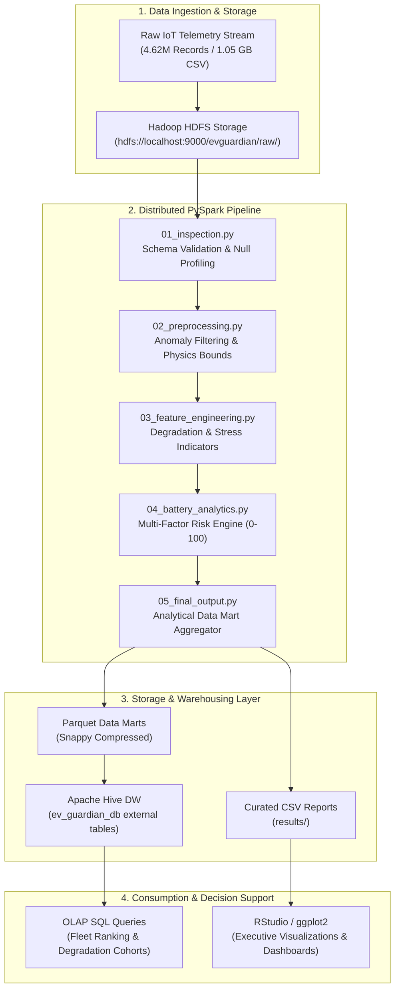

# EV Guardian: Big Data Analytics-Based EV Health Monitoring & Fault Prediction System

[](https://spark.apache.org/)
[](https://hadoop.apache.org/)
[](https://hive.apache.org/)
[](https://posit.co/)
[](#system-architecture)
[](LICENSE)

---

## 1. Executive Summary

**EV Guardian** is an enterprise-grade Big Data Analytics (BDA) pipeline designed for continuous telemetry monitoring, State of Health (SOH) degradation modeling, and early cell-level anomaly detection across electric vehicle (EV) fleets.

Electric Vehicle lithium-ion battery packs undergo non-linear electro-chemical degradation driven by thermal excursions, depth of discharge (DoD), high C-rate fast charging, and inter-cell voltage imbalances. Standard on-board Battery Management Systems (BMS) are constrained by onboard compute limits. **EV Guardian** leverages a distributed big data architecture (**Hadoop HDFS + PySpark + Apache Hive + RStudio**) to ingest, process, and analyze multi-million-row telemetry streams, isolating high-risk assets before catastrophic failure (thermal runaway or unexpected pack shutdown).

---

## 2. System Architecture



---

## 3. Technology Stack

| Layer | Component | Specification | Role |
| :--- | :--- | :--- | :--- |
| **Distributed Storage** | Apache Hadoop HDFS | v3.3.x, 128 MB Block Size | Scalable raw telemetry data lake |
| **Compute Engine** | Apache Spark / PySpark | v3.x, Python 3.10+, Local / Cluster | High-throughput in-memory ETL & analytics |
| **Data Warehouse** | Apache Hive | Metastore + HiveQL | Distributed schema-on-read & analytical queries |
| **File Formats** | Apache Parquet | Snappy Columnar Compression | High-efficiency analytical queries & storage |
| **Visual Analytics** | R & RStudio | `ggplot2`, `dplyr` | Statistical distribution & cohort visualization |

---

## 4. End-to-End PySpark Processing Pipeline

The processing workflow is structured into modular, fault-tolerant Spark jobs located in [`evguardian/pyspark/`](file:///c:/bdaproject/EV_Guardian_BDA/evguardian/pyspark):

### `01_inspection.py` — Schema Validation & Profiling
* Connects to HDFS/local filesystem and loads the raw telemetry stream.
* Enforces schema conformance across physical sensor metrics: Pack Voltage ($V$), Cell Voltages ($V_{min}, V_{max}$), Current ($I$), Temperature ($T$), State of Charge ($SOC$), and State of Health ($SOH$).
* Identifies missing values, NaN instances, and verifies distribution quantiles.

### `02_preprocessing.py` — Physics-Bounded Anomaly Cleaning
* Applies electrochemical boundary filtering:
  * Eliminates out-of-range sensor noise: Negative resistance, unrealistic temperatures ($T < -40^\circ C$ or $T > 85^\circ C$), and out-of-bound cell voltages.
* Formats ISO timestamps and temporal sequencing for temporal aggregation.
* Generates an intermediate clean Parquet sink: `data/cleaned/cleaned_telemetry.parquet`.

### `03_feature_engineering.py` — Degradation & Stress Metrics
* **Cell Imbalance Metric**: $\Delta V_{cell} = V_{max\_cell} - V_{min\_cell}$
* **Thermal Stress Index**: Flags continuous operational temperatures exceeding critical thresholds ($T > 45^\circ C$).
* **Capacity Loss**: Computes instantaneous nominal vs. delivered capacity degradation ($Ah_{loss} = Ah_{nominal} - Ah_{actual}$).
* **C-Rate & Charging Stress**: Differentiates Fast DC charging thermal cycles from AC overnight trickle charging.

### `04_battery_analytics.py` — Multi-Factor Predictive Risk Scoring
Computes a composite **Risk Score ($0 - 100$)** incorporating dynamic weighted degradation parameters:
$$\text{Risk Score} = w_1 \cdot \text{Norm}(\Delta V_{cell}) + w_2 \cdot \text{Norm}(T_{max}) + w_3 \cdot \text{Norm}(R_{int}) + w_4 \cdot (100 - SOH)$$

* Classifies vehicle health status into four operational tiers:
  * **Healthy** ($SOH \ge 90\%$, Risk $< 25$)
  * **Moderate** ($80\% \le SOH < 90\%$, $25 \le \text{Risk} < 50$)
  * **Degraded** ($70\% \le SOH < 80\%$, $50 \le \text{Risk} < 75$)
  * **Critical** ($SOH < 70\%$ or Risk $\ge 75$)

### `05_final_output.py` — Data Mart & KPI Generation
* Builds the master analytical Parquet data mart: `data/output/master_vehicle_health.parquet`.
* Exports curated CSV summaries for executive dashboards, Hive tables, and R visualization.

---

## 5. Empirical Fleet Analytics & KPIs

The pipeline was executed against **4.62 Million Telemetry Records** across a commercial and passenger EV fleet. Key benchmarks generated in [`fleet_kpi_summary.csv`](file:///c:/bdaproject/EV_Guardian_BDA/evguardian/results/fleet_kpi_summary.csv):

| Metric | Empirical Value | Description |
| :--- | :--- | :--- |
| **Total Telemetry Records** | `4,620,000` | Processed telemetry observations |
| **Total Monitored Vehicles** | `980,876` | Unique vehicle assets analyzed |
| **Fleet Average SOH** | `87.24%` | Nominal State of Health across fleet |
| **Fleet Minimum SOH** | `72.53%` | Deepest observed battery degradation |
| **Fleet Mean Operating Temp** | `28.39 °C` | Steady-state operating pack temperature |
| **Fleet Peak Operating Temp** | `33.86 °C` | Maximum monitored operational temperature |
| **Average Internal Resistance** | `32.67 mΩ` | Mean cell internal resistance ($R_{int}$) |
| **Max Cell Imbalance** | `23.67 mV` | Maximum inter-cell divergence observed |
| **Fast Charge Stress Events** | `3,202` | High-temperature DC fast charge cycles |
| **Mean Risk Score** | `5.02 / 100` | Baseline healthy fleet risk score |

---

## 6. Apache Hive Data Warehousing

SQL schemas and analytical views are configured in [`evguardian/hive_queries/`](file:///c:/bdaproject/EV_Guardian_BDA/evguardian/hive_queries):

* **Database Setup**: `01_create_database.sql` initializes `ev_guardian_db` with warehouse location on HDFS.
* **External Tables**: `02_create_table.sql` maps external schemas to distributed datasets:
  * `vehicle_health_summary` — Vehicle-level rollups and classification tiers.
  * `vehicle_type_analytics` — Comparative degradation across vehicle categories.
  * `charging_impact_analytics` — Thermal stress comparison (Fast vs. Slow charging).
  * `critical_risk_vehicles` — High-priority cohort flagged for maintenance.
* **Analytical Queries**: `03_analysis.sql` extracts the Top 20 critical assets requiring battery balancing or cell replacement.

---

## 7. Visual Analytics & Reporting Suite (RStudio)

Located in [`evguardian/rstudio/`](file:///c:/bdaproject/EV_Guardian_BDA/evguardian/rstudio), utilizing `ggplot2` and `dplyr`:

1. **`01_health_overview.R`**: SOH degradation breakdown across vehicle types and fleet health tier distributions.
2. **`02_battery_analysis.R`**: Thermal footprint comparison under DC fast-charge versus AC Level 2 charging, paired with aging cohort degradation curves.
3. **`03_final_visualization.R`**: Executive scatter analysis correlating cell imbalance ($\Delta V$) with composite risk scores and prescriptive maintenance queues.

---

## 8. Repository Structure

```text
EV_Guardian_BDA/
├── .gitignore                          # Excludes raw 1GB+ dumps, parquets & bytecode
├── README.md                           # Enterprise project documentation
└── evguardian/
    ├── data/
    │   ├── cleaned/                    # Cleaned intermediate Parquet data
    │   ├── output/                     # Final Parquet Data Marts (master_vehicle_health)
    │   └── raw/                        # Raw telemetry source (bda_dataset_1gb.csv)
    ├── hive_queries/
    │   ├── 01_create_database.sql      # Hive database initialization
    │   ├── 02_create_table.sql         # External table definitions
    │   └── 03_analysis.sql             # OLAP analytical queries
    ├── pyspark/
    │   ├── 01_inspection.py            # Telemetry profiling & schema validation
    │   ├── 02_preprocessing.py         # Physics-based anomaly cleaning
    │   ├── 03_feature_engineering.py   # Degradation & thermal stress indicators
    │   ├── 04_battery_analytics.py     # Multi-factor risk scoring engine
    │   └── 05_final_output.py          # Data mart export & KPI aggregator
    ├── results/
    │   ├── charging_impact_analytics.csv
    │   ├── critical_risk_vehicles.csv
    │   ├── degradation_by_usage_profile.csv
    │   ├── fault_distribution_analytics.csv
    │   ├── fleet_kpi_summary.csv
    │   └── vehicle_type_analytics.csv
    └── rstudio/
        ├── 01_health_overview.R        # Fleet SOH distribution plots
        ├── 02_battery_analysis.R       # Thermal stress & charging mode impact
        └── 03_final_visualization.R    # Executive risk prioritization dashboard
```

---

## 9. Getting Started

### Prerequisites
* **Python**: 3.10+ with `pyspark`, `numpy`
* **Java**: OpenJDK 8 or 11 (required for PySpark / Hadoop)
* **Hadoop / HDFS** *(Optional for local runs)*: v3.x configured in WSL / Linux
* **R Environment** *(Optional for plots)*: R 4.x with `ggplot2`, `dplyr`

### Execution

#### 1. Execute the PySpark Pipeline
Run the scripts sequentially from the workspace root:
```bash
python evguardian/pyspark/01_inspection.py
python evguardian/pyspark/02_preprocessing.py
python evguardian/pyspark/03_feature_engineering.py
python evguardian/pyspark/04_battery_analytics.py
python evguardian/pyspark/05_final_output.py
```

#### 2. Execute Hive SQL Analytics
```bash
hive -f evguardian/hive_queries/01_create_database.sql
hive -f evguardian/hive_queries/02_create_table.sql
hive -f evguardian/hive_queries/03_analysis.sql
```
*(Alternatively, query directly using PySpark's Spark SQL engine without a standalone Hive service).*

#### 3. Generate Visual Reports in R
```bash
Rscript evguardian/rstudio/01_health_overview.R
Rscript evguardian/rstudio/02_battery_analysis.R
Rscript evguardian/rstudio/03_final_visualization.R
```

---

## 10. License & Citation

* **Project**: EV Guardian Big Data Analytics Pipeline
* **Application**: Electric Vehicle Battery Health Prediction & Early Fault Warning
* **License**: MIT License
